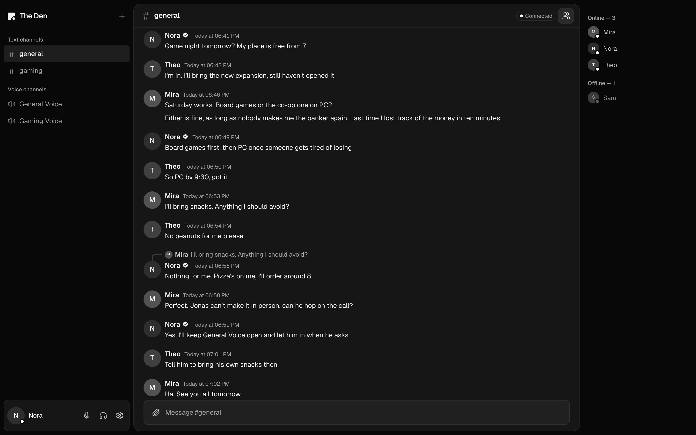
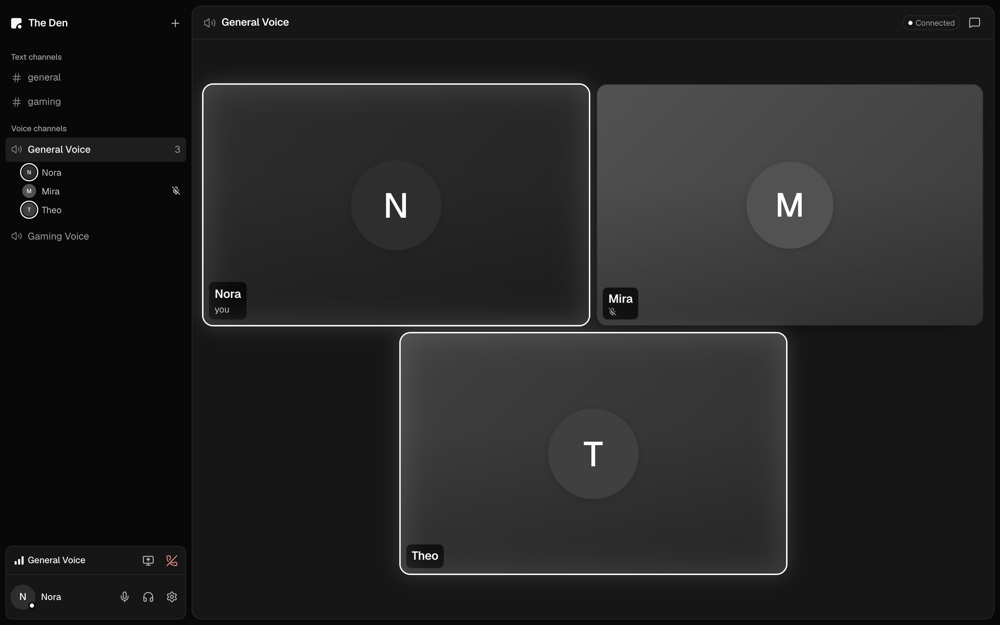
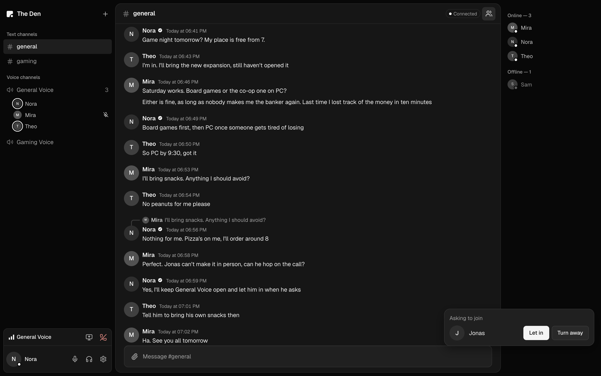

<p align="center">
  
</p>

<h1 align="center">Hostile</h1>

<p align="center">
  <strong>Voice, screen sharing and text chat, hosted from your own PC.</strong>
</p>

<p align="center">
  One friend runs the desktop app and gets a room code. Everyone else pastes the code and asks to join,<br>
  and the host clicks Let in. No accounts, no sign-up, no rented server.
</p>

<p align="center">
  <a href="https://github.com/xDenside/Hostile/actions/workflows/ci.yml"></a>
</p>

<p align="center">
  <a href="#status">Early preview 0.1.0, runs from source for now</a> · <a href="LICENSE">Apache-2.0</a> · <a href="#run-from-source">Run from source</a> · <a href="docs/DESIGN.md">Design</a>
</p>



## How it works

1. **Host a room.** Open the desktop app and choose Host a room. Pick a nickname and, if you like, an avatar and a
   background. The app gives you a room code: about 128 random bits, made to be pasted rather than typed.
2. **Share the code.** Send it to your friends however you usually talk.
3. **Let them in.** A friend chooses Join with a code, pastes it, fills in one card (a nickname and optional pictures)
   and clicks Ask to join. You see who is asking and click Let in or Turn away. Nothing about them is stored until
   you click Let in, and next time the same device comes straight back in.

That is the whole sign-up. There are no accounts, passwords or emails anywhere.

## Features

### Text chat

- **Live, and it catches up.** Send, edit and delete messages; everyone sees the change at once. A client that drops
  off catches up on exactly what it missed, and a retried send never shows up twice.
- **Formatting.** Bold, italic, underline, strikethrough, inline code, code blocks and clickable links. Message text is
  never rendered as HTML.
- **Replies and forwards.** A reply quotes the original, stays current if it is edited or deleted, and jumps to it on a
  click, however far back. A forward copies a message, with its pictures and videos, into another channel.
- **Images and videos.** Paste, drag in or pick up to 10 per message: images up to 25 MB, MP4, MOV and WebM videos up
  to 200 MB. Uploads show real progress, with Retry and Cancel. Videos play with seeking, and nothing is re-encoded.
  Other file types, such as documents and archives, are not supported.
- **Who is around.** Typing indicators, online and offline with a custom status, and an unread dot on each channel.
- **Chat beside every call.** Each voice channel has its own text chat next to the call.

### Voice and screen sharing

- **Voice channels.** Join, mute, deafen and leave. Turn one person up to 200% on a computer, or mute them just for
  yourself. Bars show how your connection is doing, and a tile says when someone's is weak.
- **Screen sharing.** Share a screen or a window at 720p 30 fps, 1080p 15 fps for sharp text, or 1080p 30 fps,
  optionally with its sound where the operating system allows it. Viewers can enlarge one stream or watch it
  fullscreen.
- **Noise suppression.** Four settings: Off, Standard (the browser's own), Enhanced (RNNoise) and Strong
  (FastEnhancer), which is the default. Both models run on your own machine in WebAssembly, and if Strong cannot keep
  up, it drops back to Standard. Echo cancellation, automatic gain control and a microphone test with playback sit
  beside them.
- **Call sounds and shortcuts.** Sounds for joins, leaves, mute, deafen and screen shares, heard only by you, with a
  preview of each and one switch to turn them off. Keyboard shortcuts for Mute, Deafen and fullscreen stream can be
  changed, and in the desktop app Mute and Deafen can also work while another app is in front.

### Hosting

- **A Hosting tab.** It shows the code, the waiting list, who is connected and the state of each part in plain words.
  Make a new code and the old one stops working, cutting everyone off until they paste the new one. Or stop hosting.
- **Requests that stay out of the way.** A small card that takes no focus, and a system notification with the
  person's name when the window is closed or in the background.
- **Members and channels.** Remove someone and their sessions, calls and media end at once; their messages stay.
  Create, rename, reorder, archive and restore text and voice channels. There is one owner, and everyone else is a
  member.
- **Recovers by itself.** Each part of the room restarts on its own after a crash, up to five times in five minutes.
  Guests see that the host is away within about 12 seconds and reconnect when it comes back. The app keeps the PC
  awake while it hosts.

### Profiles

- **Your profile.** A nickname, an avatar (animated GIFs included), a profile background, a custom status, nine name
  fonts, name effects such as neon, aurora and glitch, and name colours. Two people may share a nickname.

### Privacy

- **No accounts.** A person is a nickname and pictures on one device.
- **Your room lives on the host's PC.** The database and every uploaded file sit in one folder on the host's computer.
  The database is PGlite, PostgreSQL compiled to WebAssembly, so there is nothing to install.
- **Location stripped from uploads.** Location data in photos and in MP4 and MOV videos is removed before anyone can
  download the file. WebM and a few other cases are not covered; [docs/SECURITY.md](docs/SECURITY.md) lists them.
- **No telemetry.** No analytics, no crash reporting, no auto-updater, and the app loads nothing from a CDN. It does
  use public Nostr relays to find the host and public STUN servers to set up connections; see
  [Limitations](#limitations).

## Screenshots

<table>
  <tr>
    <td width="50%" align="center"><br><sub>A call in General Voice. The white ring shows who is talking.</sub></td>
    <td width="50%" align="center"><br><sub>Jonas asks to join. The host clicks Let in or Turn away.</sub></td>
  </tr>
</table>

## Under the hood

Every guest connects to the host and to nobody else. Public Nostr relays help a guest find the host. The code names the
host's own signing key, so a guest believes only that host, and seals what it puts on the relay so only that host can
read it. After that, the app's requests, live updates and call signalling
travel through a tunnel over WebRTC data channels, and voice and screen shares go straight to a LiveKit media server
running on the host's PC. If a connection fails, the join screen says which step failed.

The desktop app runs the whole room: a room server (Express and Socket.IO) with its database, the tunnel gateway and
LiveKit, each restarted if it crashes. Only LiveKit's single UDP media port listens beyond the PC itself. The client
is React and TypeScript, the same code in the desktop app (Electron) and in a browser.
[docs/ARCHITECTURE.md](docs/ARCHITECTURE.md) and [docs/DESIGN.md](docs/DESIGN.md) go into detail.

## Status

Hostile is an early preview, version 0.1.0. The app is built and tested, but there is nothing to install yet.

**Working today**

- The app: text chat, voice, screen sharing and room admin, with the database built in.
- Hosting from the desktop app: Host a room, Join with a code, Ask to join and Let in, with no login.
- Joining with a code: finding the host through the relays, and the tunnel that connects each guest to the host for
  chat, files, calls and screen shares.
- An Apple Silicon macOS package with the media server inside, built and run on one Mac.
- CI on every push to main and every pull request: unit, integration and durability tests; Playwright in Chromium, once directly
  and once with every user going through the tunnel; a smaller, non-blocking set in Firefox, WebKit and an iPhone profile; and the
  desktop app in real Electron on macOS.

**Coming next**

- **Installers.** No release is published, so for now everyone, the host and their friends, runs Hostile from source. The Mac package is not signed or
  notarized yet, and Windows and Linux packages have not been built.
- **Browser and phone guests.** A guest build lets a browser tab join over the tunnel, and it passes the tests, but no
  public page serves it yet. Until one does, friends join from the desktop app, run from source.
- **Real networks.** Every test so far runs both ends on one machine. Home routers, carrier NAT and guests on mobile
  data have not been tried.
- **Real hardware.** Real phones, real microphones by ear, Safari and Firefox file handling, and sleep and wake are
  still to be checked. There is no auto-update yet.

## Limitations

- **The room lasts while the host's PC is on.** The app keeps the PC awake, but closing a laptop lid ends the room
  until it opens again. There is no second host.
- **Upload speed sets the room's size.** Voice is light, about 0.6 Mbps of upload for 5 people talking. One 1080p
  screen share to 9 viewers needs about 41 Mbps. Hostile is designed for groups of 3 to 10.
- **Some networks cannot connect directly.** Published estimates put this at 8-25% of sessions. The project runs no
  relay; the join screen takes a TURN relay of your own, which has not been tested yet.
- **Built for friends, not strangers.** Connections are encrypted in transit, but not end to end: the host's PC can
  read every message and could record calls. Every guest, and anyone holding the code, learns the host's IP address.
  Someone with the code cannot read a guest's on the relays, but any relay operator can see every guest's.
- **A person is their device.** A new device or cleared browser data is a new person, who asks to join again. There
  is no account to recover, link or export.

There are no reactions, mentions, direct messages, threads, search, webcams or push-to-talk for now.
[docs/LIMITATIONS.md](docs/LIMITATIONS.md) lists what is left out and why, and what has not been checked on real
hardware.

## Run from source

You need Node.js 24, pnpm 11 and `livekit-server`. On macOS, install LiveKit with `brew install livekit`; on Windows
and Linux, `pnpm livekit:install` downloads LiveKit from its GitHub release and checks it against the release's checksums (x64 only). No domain, accounts
or router changes are needed.

```bash
git clone https://github.com/xDenside/Hostile.git
cd Hostile
pnpm install
pnpm setup:local    # creates .env with random dev secrets, checks LiveKit, offers dev-only test people
pnpm dev            # LiveKit + API + web client, stops together on Ctrl+C
```

Open <http://localhost:5190>. It opens on the Ask to join card, and nobody is at a host's screen to let you in. To
get in on your own, set `JOIN_AUTO_ADMIT=true` in `.env` (development only), or become the owner as
[docs/SETUP.md, section 3](docs/SETUP.md#3-who-you-are) describes. A private window is a second person.

To try hosting in the desktop app:

```bash
pnpm dev:desktop                                # the app, choosing Host a room or Join with a code
pnpm dev:desktop -- --profile=bob --no-build    # a second person, in another terminal
pnpm package:desktop                            # Apple Silicon Mac only for now; see docs/DESKTOP.md
```

`pnpm check` checks tools, ports, `.env`, the database and LiveKit. `pnpm test` runs the unit and integration tests,
and `pnpm test:e2e` and `pnpm test:e2e:desktop` the browser and desktop suites (run
`pnpm exec playwright install chromium` once first). CI runs on Ubuntu and macOS; the
commands should be the same on Windows, which has not been tried yet.

## Documents

| Document                                                 | What it covers                                                                                                     |
| -------------------------------------------------------- | ------------------------------------------------------------------------------------------------------------------ |
| [docs/DESIGN.md](docs/DESIGN.md)                         | How hosting from a PC works: the star shape, the tunnel, finding the host, the database, what hosting costs        |
| [docs/ARCHITECTURE.md](docs/ARCHITECTURE.md)             | How the app is put together: client, API, database and LiveKit; message order, attachments, sessions, voice        |
| [docs/SETUP.md](docs/SETUP.md)                           | Running it from source: prerequisites, `.env`, getting in on a dev server, ports, commands, troubleshooting        |
| [docs/TESTING.md](docs/TESTING.md)                       | The test suites and what each one proves                                                                           |
| [docs/SECURITY.md](docs/SECURITY.md)                     | The trust model: who gets in, sessions, media tokens, desktop hardening, upload checks                             |
| [docs/LIMITATIONS.md](docs/LIMITATIONS.md)               | What the app does not do or has not verified yet, including noise-suppression measurements                         |
| [docs/DESKTOP.md](docs/DESKTOP.md)                       | The Electron app: development runs, packaging, opening an unsigned app, macOS permissions, the hosting parts       |
| [docs/ASSETS.md](docs/ASSETS.md)                         | Licence audit of fonts, call sounds, the logo, noise-suppression code, bundled programs and dependencies           |
| [docs/third-party-licences/](docs/third-party-licences/) | Licence texts for code compiled into Hostile: RNNoise, rnnoise-wasm, FastEnhancer, PostgreSQL and LiveKit's NOTICE |

## Security

Hostile is not end-to-end encrypted, by design. [docs/SECURITY.md](docs/SECURITY.md) explains what the host can see,
who gets in and how the desktop app is hardened.

## Licence

Hostile is licensed under the [Apache License 2.0](LICENSE); see also [NOTICE](NOTICE). Third-party code and assets
keep their own licences: [docs/ASSETS.md](docs/ASSETS.md) has the audit, and
[docs/third-party-licences/](docs/third-party-licences/) holds the texts.
